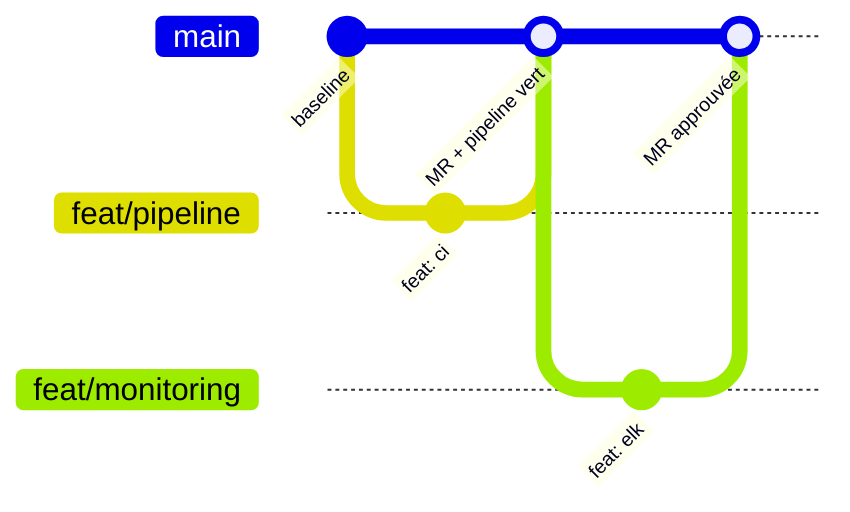
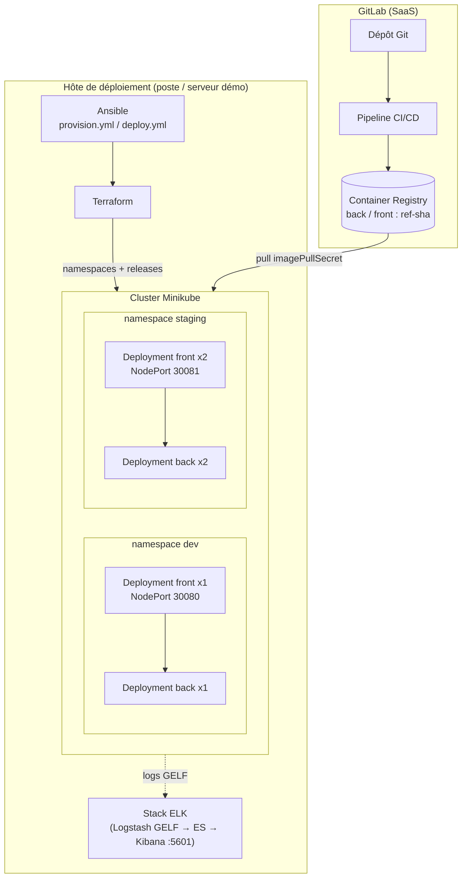
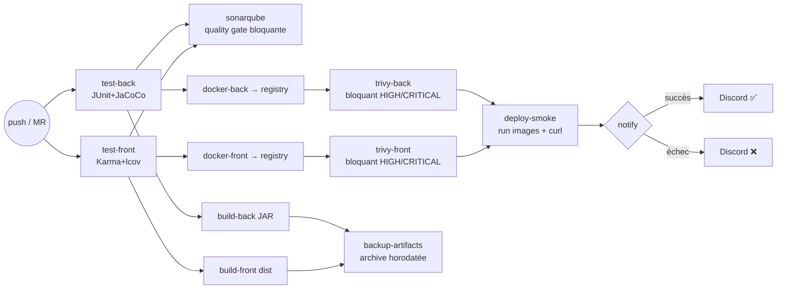

# Documentation CI/CD complète — Orion Full-Stack

**Auteur** : Ghislain Adon, Expert DevOps — **Version** : 1.0 — juillet 2026

---

## 1. Introduction

### 1.1 Présentation du document

Cette documentation décrit la chaîne CI/CD complète mise en place pour l'application
Full-Stack d'Orion (MicroCRM) : workflow de branches, stratégie de tests, architecture
IaC, sécurité intégrée et automatisation des releases. Elle sert de référence unique
aux équipes Dev et Ops.

### 1.2 Technologies principales

| Catégorie | Outil | Rôle |
|---|---|---|
| CI/CD | GitLab CI (runners SaaS) | Orchestration du pipeline (7 stages) |
| Qualité | SonarQube Community | Analyse statique Java + TypeScript, quality gate bloquante |
| Sécurité | Trivy | Scan CVE des images, bloquant HIGH/CRITICAL |
| Conteneurs | Docker + GitLab Container Registry | Images non-root taguées `<branche>-<SHA>`, registre interne |
| Orchestration | Kubernetes (Minikube) + Helm | Déploiements dev/staging, probes, réplicas |
| IaC | Terraform + Ansible | Provisionnement namespaces/releases + automatisation déploiement |
| Monitoring | Stack ELK (+ script DORA) | Centralisation logs, dashboards, métriques de livraison |
| Scripts | Bash + Python | Dépendances, back-up, déploiement smoke, notifications Discord |

## 2. Contexte et objectifs du projet

### 2.1 Contexte

Orion développe une application Full-Stack (Angular 17 / Spring Boot 3) proche de sa
première mise en production. Les sondages des équipes ont révélé : un pipeline CI
réduit aux tests, des images construites manuellement sur poste en fin de sprint, un
contrôle de sécurité (Trivy) exécuté par les Ops **après** livraison — provoquant des
« retours à l'envoyeur » (premier déploiement de démo retardé par des CVE), un
déploiement manuel par 2 personnes, une dépendance à DockerHub, et une équipe Dev
débutante sur la moitié Java du stack.

### 2.2 Objectifs du projet

1. **Automatiser** la chaîne complète du commit à l'image déployable (zéro opération manuelle).
2. **Sécuriser en amont** (shift-left) : scan CVE et quality gate bloquants dans le pipeline.
3. **Tracer** chaque artefact : image ↔ commit via le tag `<branche>-<SHA court>` dans le registre interne.
4. **Mesurer** : couverture de tests remontée, métriques DORA calculées automatiquement.
5. **Accélérer le feedback** : résultat de pipeline notifié aux 2 équipes en < 15 min.

## 3. Workflow de branches

### 3.1 Modèle de branching choisi

**GitLab Flow simplifié** : branches de fonctionnalité courtes fusionnées par merge
request dans la branche d'intégration. Adapté à une équipe de 4 développeurs avec
un seul produit et des intégrations quotidiennes — Git Flow serait surdimensionné,
le trunk-based pur prématuré pour une équipe junior sur Java.

### 3.2 Structure des branches



- `master` : production/baseline — **protégée** (pas de push direct).
- `feat/<sujet>` : branches courtes (< 3 jours), une MR par fonctionnalité.
- Politique de merge : **1 approbation** (lead/senior) + **pipeline vert** (tests + quality gate + scans) obligatoires.

### 3.3 Convention de nommage

- Branches : `feat/<sujet>`, `fix/<sujet>`, `ci/<sujet>` en kebab-case.
- Commits : **Conventional Commits** (`feat:`, `fix:`, `chore:`, `docs:`, `ci:`) — base d'un versioning sémantique automatisable.

## 4. Stratégie de tests automatisés

### 4.1 Types de tests implémentés

| Type de test | Outil | Déclenchement | Couverture cible |
|---|---|---|---|
| Unitaires back | JUnit 5 + JaCoCo | Chaque push (stage `test`) | ≥ 60 % (cible 80 %) |
| Unitaires front | Karma/Jasmine + lcov | Chaque push (stage `test`) | ≥ 50 % (cible 70 %) |
| Intégration | spring-boot-starter-test (JPA/REST, HSQLDB mémoire) | Chaque push | inclus back |
| Sécurité images | Trivy | Chaque push (stage `security`) | 0 CVE HIGH/CRITICAL |
| Sécurité code | SonarQube (hotspots) + `npm audit`/arbre Gradle | Chaque MR / push | 0 hotspot non revu |
| Smoke déploiement | `deploy_demo.sh` (curl) | Stage `deploy` | 2 services HTTP 200 < 60 s |

### 4.2 Intégration dans le pipeline GitLab CI

Stages `test` (rapports JUnit publiés dans l'UI des MR, couverture en artefact) →
`quality` → `package` → `security` → `backup` → `deploy` → `notify`. Les jobs
utilisent des caches par branche (npm, Gradle, base Trivy, cache Sonar) pour un
feedback < 15 min. Jobs conditionnels par variables (`SONAR_HOST_URL`,
`DISCORD_WEBHOOK_URL`) : le pipeline reste fonctionnel même sans ces intégrations.

### 4.3 Quality Gate SonarQube

Critères : 0 bug bloquant/critique nouveau, 0 hotspot sécurité non revu, couverture
sur code nouveau ≥ 60 %, duplication < 3 %. Le job `sonarqube` attend le verdict
(`sonar.qualitygate.wait=true`) : **échec de la gate = pipeline rouge = merge
impossible**. Adoption progressive : 2 semaines d'observation avant mode bloquant,
seuils relevés par paliers (60 → 80 %).

## 5. Architecture IaC et Cloud

### 5.1 Vue d'ensemble de l'architecture

Option retenue : **infrastructure locale reproductible** (Docker + Minikube),
explicitement autorisée par le projet — zéro coût, démontrable hors-ligne, et
portable vers un cloud managé (EKS/AKS) sans changer les charts. Architecture
applicative **2-tiers conteneurisée** (front statique servi par Caddy, API Spring
Boot), provisionnée par **Terraform** (namespaces + releases Helm) et automatisée
par **Ansible** (provision de l'hôte + déploiement + smoke test).

### 5.2 Schémas d'architecture

#### 5.2.1 Schéma d'infrastructure



#### 5.2.2 Schéma du pipeline CI/CD



### 5.3 Environnements

| Environnement | Branche(s) | Type de déploiement | URL | Particularités |
|---|---|---|---|---|
| CI éphémère | toutes | conteneurs de jobs + dind | — | jetable, smoke deploy inclus |
| Development | branches feat/intégration | Helm `values-dev` via Terraform | NodePort 30080 | 1 replica par composant |
| Staging | branche d'intégration | Helm `values-staging` via Terraform | NodePort 30081 | 2 replicas (résilience) |
| Production (cible) | `master` | promotion manuelle des mêmes images | — | non déployée dans le cadre du projet |

### 5.4 Structure du code IaC

```
deploy/
├── helm/microcrm/          # Chart : templates back/front (probes, resources),
│   └── values{,-dev,-staging}.yaml
├── terraform/              # Namespaces + helm_release par environnement
│   └── main.tf variables.tf outputs.tf
└── ansible/                # provision.yml (outillage hôte) + deploy.yml
    └── inventory.ini       #   (Terraform → pods Ready → smoke HTTP)
monitoring/elk/             # compose ES + Logstash (GELF) + Kibana
```

## 6. Sécurité et qualité du code

### 6.1 Approche DevSecOps

Contrôles **shift-left** : chaque commit passe l'analyse statique, l'audit de
dépendances et le scan d'images **avant** toute mise à disposition — le contrôle
manuel post-livraison des Ops est supprimé, l'échec est détecté en minutes.

### 6.2 Outils de sécurité intégrés

| Outil | Contrôle | Politique |
|---|---|---|
| Trivy | CVE des images (OS + librairies embarquées) | Bloquant HIGH/CRITICAL, exceptions via `.trivyignore` justifié et revu |
| SonarQube | Bugs, hotspots sécurité, dette | Quality gate bloquante en MR |
| `check_deps.sh` | `npm audit` + arbre Gradle | Rapport d'observation en artefact |
| Dockerfile | Utilisateurs **non-root** (UID 10001), images de base épinglées, `apk upgrade`, 1 processus/conteneur | Revue obligatoire |

**Cas réel traité pendant le projet** : le premier scan a bloqué 28 CVE
(4 CRITICAL sur Tomcat embarqué 10.1.20). Remédiation : montée de version Spring
Boot 3.2.5 → 3.5.x + surclassement Tomcat/jackson/json-smart + `apk upgrade` des
images ; les 2 CVE résiduelles du binaire Caddy (stdlib Go, classe DoS, sans
correctif upstream) sont documentées et gouvernées dans `.trivyignore`.

### 6.3 Gestion des secrets

Variables CI/CD GitLab **masquées et protégées** (`SONAR_TOKEN`,
`DISCORD_WEBHOOK_URL`) ; jetons registre éphémères fournis par GitLab
(`$CI_REGISTRY_*`) ; en local `.env` gitignoré (gabarit `.env.example`) ; aucun
secret dans les images ni dans l'historique Git ; `imagePullSecret` Kubernetes créé
hors chart.

### 6.4 Processus de traitement des vulnérabilités

1. Pipeline rouge sur le job `trivy-*` → notification Discord.
2. Lecture du rapport (artefact `reports/trivy-*.txt`).
3. Remédiation par ordre de préférence : mise à jour de dépendance/BOM → mise à jour d'image de base/`apk upgrade` → exception `.trivyignore` **justifiée, datée et revue par les Ops** (uniquement si aucun correctif n'existe).
4. Re-scan automatique au push suivant ; réévaluation des exceptions à chaque release d'image de base.

## 7. Automatisation des releases et rollback

### 7.1 Stratégie de déploiement

Livraison continue par images immuables : chaque commit d'intégration produit des
images `<branche>-<SHA>` prêtes à déployer ; la promotion vers staging/production est
un simple changement de tag dans les values Helm (via `terraform apply -var image_tag=`),
exécutée par le playbook Ansible.

### 7.2 Pipeline de release

Le stage `package` publie les artefacts (JAR, bundle, images) ; `security` les
valide ; `deploy` prouve leur déployabilité (smoke). La release vers un environnement
durable = `ansible-playbook deploy.yml -e image_tag=<tag validé>`.

### 7.3 Système de versioning

- **Images** : `<branche>-<SHA court>` (traçabilité exacte) ; tag `latest` jamais utilisé en déploiement.
- **Code** : Conventional Commits → permet d'introduire semantic-release (tags `vX.Y.Z`) sans changement de process (évolution planifiée).
- **Chart Helm** : `version`/`appVersion` dans `Chart.yaml`.

### 7.4 Procédure de rollback

1. Identifier le dernier tag sain (historique du registre ou `reports/dora_metrics.json`).
2. `ansible-playbook deploy.yml -e image_tag=<tag précédent>` — Helm effectue un rolling update inverse ; alternative directe : `helm rollback microcrm <révision> -n <env>`.
3. Si l'artefact n'est plus dans le registre : restaurer depuis l'archive `backups/backup-<ts>-<sha>.tar.gz` (checksum SHA-256 vérifié).
4. Post-mortem : cause dans le backlog + test de non-régression.

### 7.5 Scripts d'automatisation

| Script | Rôle |
|---|---|
| `scripts/check_deps.sh` | Audit des dépendances (npm/Gradle) en rapport d'artefact |
| `scripts/backup.sh` | Archive horodatée + checksum des artefacts déployables |
| `scripts/deploy_demo.sh` | Déploiement des 2 images + vérification HTTP (CI et poste) |
| `scripts/notify_discord.py` | Notification embed du résultat de pipeline |
| `scripts/dora_metrics.py` | Calcul des 4 métriques DORA depuis l'API GitLab |

### 7.6 Stratégie de backup

Archive `tar.gz` horodatée (UTC) + SHA du commit à chaque pipeline (stage `backup`,
rétention 1 semaine en artefact GitLab) ; les images du registre constituent le
backup de niveau exécutable (rétention par politique du registre) ; le code et l'IaC
sont versionnés dans Git (dépôt + miroir GitHub).

### 7.7 Monitoring et alerting

Stack **ELK** : les conteneurs émettent leurs logs via le driver GELF → Logstash
(enrichissement composant/verbe/statut HTTP) → Elasticsearch (`orion-logs-*`) →
dashboards Kibana (santé, erreurs, latences). **Alerting** : notification Discord à
chaque échec de pipeline ; métriques **DORA** (fréquence de déploiement, lead time,
change failure rate, MTTR) calculées par `dora_metrics.py` et intégrées au rapport
de performance.

## 8. Annexes

- Dépôt GitLab : `https://gitlab.com/adon88463114/opc-p6-gerez_une_demarche_devops` (branche `solution`)
- `docs/01-veille-audit-recommandations.md` — audit, veille, recommandations (Modèle 1)
- `docs/02-normalisation-plan-ci.md` — normalisation + plan de mise en œuvre (Modèle 2)
- `docs/03-plan-tests-securite.md` — plan de tests et de sécurité détaillé
- `README.md` — guide d'exécution : jobs du pipeline, scripts (but/fonctionnement/paramètres), Helm/Terraform/Ansible/ELK
- Rapports de pipeline : artefacts GitLab (JUnit, couverture, Trivy, backups, DORA)
