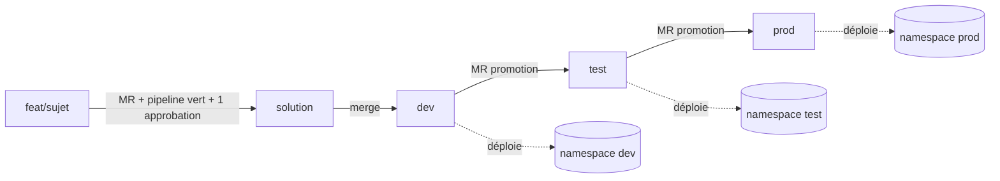
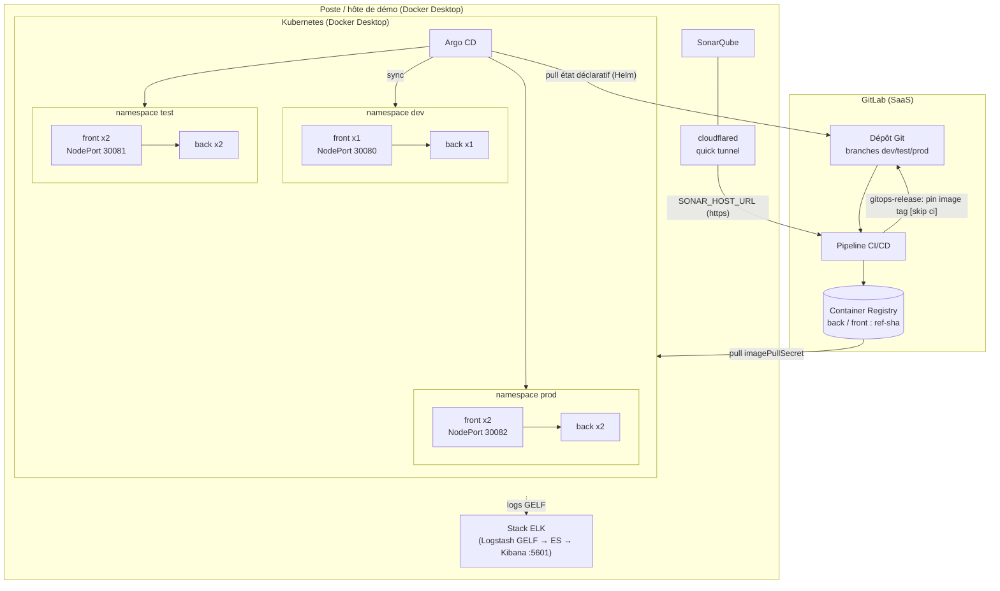
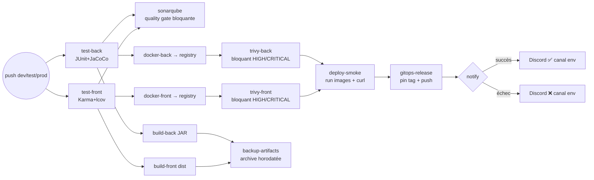

# Documentation CI/CD complète — Orion Full-Stack

**Auteur** : Ghislain Adon, Expert DevOps — **Version** : 2.0 — juillet 2026

---

## 1. Introduction

### 1.1 Présentation du document

Cette documentation décrit la chaîne CI/CD complète mise en place pour l'application
Full-Stack d'Orion (MicroCRM) : workflow de branches, stratégie de tests, architecture
IaC, sécurité intégrée, **déploiement continu par GitOps** et automatisation des
releases/rollback. Elle sert de référence unique aux équipes Dev et Ops.

### 1.2 Technologies principales

| Catégorie | Outil | Rôle |
|---|---|---|
| CI/CD | GitLab CI (runners SaaS) | Orchestration du pipeline (9 stages) |
| Qualité | SonarQube Community | Analyse statique Java + TypeScript, quality gate bloquante |
| Exposition | Cloudflare Tunnel (`cloudflared`) | Expose le SonarQube local aux runners GitLab, sans ouvrir de port entrant |
| Sécurité | Trivy | Scan CVE des images, bloquant HIGH/CRITICAL |
| Conteneurs | Docker + GitLab Container Registry | Images non-root taguées `<branche>-<SHA>`, registre interne |
| Orchestration | Kubernetes (Docker Desktop) + Helm | Déploiements dev/test/prod, probes, réplicas |
| **CD / GitOps** | **Argo CD** | Réconciliation continue du cluster avec l'état Git (pull), sync auto + self-heal |
| IaC | Terraform + Ansible | Provisionnement namespaces/releases + portabilité cloud (EKS/AKS) |
| Monitoring | Stack ELK (+ script DORA) | Centralisation logs, dashboards, métriques de livraison |
| Scripts | Bash + Python | Dépendances, back-up, release GitOps, notifications Discord, DORA |

## 2. Contexte et objectifs du projet

### 2.1 Contexte

Orion développe une application Full-Stack (Angular 17 / Spring Boot 3) proche de sa
première mise en production. Les sondages des équipes ont révélé : un pipeline CI
réduit aux tests, des images construites manuellement sur poste en fin de sprint, un
contrôle de sécurité (Trivy) exécuté par les Ops **après** livraison — provoquant des
« retours à l'envoyeur » (premier déploiement de démo retardé par des CVE), un
déploiement manuel par 2 personnes, une dépendance à DockerHub, et une équipe Dev
débutante sur la moitié Java du stack.

### 2.2 Objectifs du projet

1. **Automatiser** la chaîne complète du commit au déploiement (zéro opération manuelle).
2. **Sécuriser en amont** (shift-left) : scan CVE et quality gate bloquants dans le pipeline.
3. **Tracer** chaque artefact : image ↔ commit via le tag `<branche>-<SHA court>` dans le registre interne.
4. **Fiabiliser le déploiement** : GitOps (Argo CD), état déclaratif versionné, promotion contrôlée dev → test → prod.
5. **Mesurer** : couverture de tests remontée, métriques DORA calculées automatiquement.
6. **Accélérer le feedback** : résultat de pipeline notifié à l'équipe de l'environnement en < 15 min.

## 3. Workflow de branches

### 3.1 Modèle de branching choisi

Deux niveaux complémentaires :

- **Intégration** — GitLab Flow simplifié : branches de fonctionnalité courtes
  (`feat/<sujet>`) fusionnées par merge request dans `solution`, la branche
  **source de vérité** évaluée. Merge conditionné à *1 approbation* + *pipeline vert*.
- **Livraison** — **branches d'environnement** : `solution` est promue vers trois
  environnements homonymes `dev` → `test` → `prod`. Chaque branche d'environnement
  est reliée à un namespace Kubernetes et à un canal de notification dédiés.

Git Flow serait surdimensionné pour une équipe de 4 développeurs ; le trunk-based pur
prématuré pour une équipe junior sur Java. Le couple *intégration + branches
d'environnement* offre une promotion traçable, réversible et démontrable.

### 3.2 Structure des branches et flux de promotion



- `solution` : source de vérité **évaluée** ; exécute la CI mais ne déploie pas.
- `dev` / `test` / `prod` : branches **protégées** ; un push déclenche la pipeline
  puis, en cas de succès, la release GitOps (déploiement automatique de l'environnement).
- `master` : conserve l'état initial (baseline importée), non déployé.

### 3.3 Règles de protection et de promotion

- `test` et `prod` sont des branches protégées (pas de push direct).
- Le job `promotion-guard` **rejette toute merge request hors flux** : `prod`
  n'accepte des merges que depuis `test`, `test` que depuis `dev`. La règle, que la
  seule protection de branche GitLab ne peut exprimer, est ainsi rendue explicite et
  vérifiable dans le pipeline.

### 3.4 Convention de nommage

- Branches d'intégration : `feat/<sujet>`, `fix/<sujet>`, `ci/<sujet>` en kebab-case.
- Commits : **Conventional Commits** (`feat:`, `fix:`, `chore:`, `docs:`, `ci:`) — base d'un versioning sémantique automatisable.

## 4. Stratégie de tests automatisés

### 4.1 Types de tests implémentés

| Type de test | Outil | Déclenchement | Couverture cible |
|---|---|---|---|
| Unitaires back | JUnit 5 + JaCoCo | Chaque push (stage `test`) | ≥ 60 % (cible 80 %) |
| Unitaires front | Karma/Jasmine + lcov | Chaque push (stage `test`) | ≥ 50 % (cible 70 %) |
| Intégration | spring-boot-starter-test (JPA/REST, HSQLDB mémoire) | Chaque push | inclus back |
| Sécurité images | Trivy | Chaque push (stage `security`) | 0 CVE HIGH/CRITICAL |
| Sécurité code | SonarQube (hotspots) + `npm audit`/arbre Gradle | Chaque MR / push | 0 hotspot non revu |
| Smoke (build) | `deploy_demo.sh` (curl) | Stage `verify` | 2 services HTTP 200 < 60 s |

### 4.2 Intégration dans le pipeline GitLab CI

Neuf stages : `.pre` (promotion-guard) → `test` → `quality` → `package` → `security`
→ `backup` → `verify` → `release` → `notify`. Les rapports JUnit sont publiés dans
l'UI des MR, la couverture conservée en artefact. Les jobs utilisent des caches par
branche (npm, Gradle, base Trivy, cache Sonar) pour un feedback < 15 min. Jobs
conditionnels par variables (`SONAR_HOST_URL`, `GITOPS_PUSH_TOKEN`) : le pipeline
reste fonctionnel même sans ces intégrations.

### 4.3 Quality Gate SonarQube

Critères : 0 bug bloquant/critique nouveau, 0 hotspot sécurité non revu, couverture
sur code nouveau ≥ 60 %, duplication < 3 %. Le job `sonarqube` attend le verdict
(`sonar.qualitygate.wait=true`) : **échec de la gate = pipeline rouge = release
impossible**. L'instance SonarQube tourne sur le poste et est jointe par les runners
GitLab via un tunnel Cloudflare (cf. §5.5). Adoption progressive : 2 semaines
d'observation avant mode bloquant, seuils relevés par paliers (60 → 80 %).

## 5. Architecture IaC, Cloud et GitOps

### 5.1 Vue d'ensemble de l'architecture

Option retenue : **infrastructure locale reproductible** (Docker Desktop + Kubernetes
intégré), explicitement autorisée par le projet — zéro coût, démontrable hors-ligne,
et **portable** vers un cloud managé (EKS/AKS) sans changer les charts. Le déploiement
est piloté en **GitOps** : le pipeline ne pousse jamais vers le cluster ; c'est
**Argo CD**, exécuté sur le poste, qui *tire* l'état déclaratif depuis Git et
réconcilie le cluster. Application **2-tiers conteneurisée** (front statique servi par
Caddy, API Spring Boot). Terraform + Ansible restent disponibles pour le
provisionnement et la portabilité cloud.

### 5.2 Principe GitOps (pull, pas de flux entrant)

1. Un push sur `dev`/`test`/`prod` exécute la pipeline (tests, gate, build, scans).
2. En cas de succès, le job `gitops-release` **épingle** l'image construite
   (`image.registry` + `image.tag`) dans `values-<env>.yaml` et pousse ce commit
   `[skip ci]` sur la branche d'environnement.
3. Argo CD détecte le changement, synchronise et déploie dans le namespace `<env>`.

Conséquence de sécurité majeure : **le cluster n'expose aucun accès entrant** aux
runners GitLab. Seul SonarQube est exposé, en sortie, via un tunnel.

### 5.3 Schéma d'infrastructure



### 5.4 Schéma du pipeline CI/CD



### 5.5 Exposition de SonarQube par tunnel Cloudflare

Le SonarQube local est publié aux runners GitLab par un **quick tunnel**
`cloudflared` (`https://<aléatoire>.trycloudflare.com`) — connexion **sortante** du
poste, aucun port entrant ouvert. L'URL est injectée dans la variable CI
`SONAR_HOST_URL`. L'URL d'un quick tunnel changeant à chaque session, le script de
bootstrap la régénère et met à jour la variable via l'API GitLab (cf. §8.2).

### 5.6 Environnements

| Environnement | Branche | Namespace | Déploiement | Accès | Particularités |
|---|---|---|---|---|---|
| CI éphémère | toutes | — | conteneurs de jobs + dind | — | jetable, smoke `verify` inclus |
| Development | `dev` | `dev` | Argo CD ← `values-dev` | NodePort 30080 | 1 replica par composant |
| Test | `test` | `test` | Argo CD ← `values-test` | NodePort 30081 | 2 replicas (résilience) |
| Production | `prod` | `prod` | Argo CD ← `values-prod` | NodePort 30082 | 2 replicas, branche protégée |

### 5.7 Structure du code IaC / GitOps

```
deploy/
├── helm/microcrm/          # Chart : templates back/front (probes, resources),
│   └── values{,-dev,-test,-prod}.yaml   # image.tag épinglé par la release GitOps
├── argocd/                 # 1 Application Argo CD par environnement
│   └── application-{dev,test,prod}.yaml
├── terraform/              # Namespaces + helm_release (portabilité / alternative)
│   └── main.tf variables.tf outputs.tf
└── ansible/                # provision.yml (outillage hôte) + deploy.yml
    └── inventory.ini
monitoring/elk/             # compose ES + Logstash (GELF) + Kibana
scripts/                    # gitops_release.sh, backup.sh, deploy_demo.sh, *.py
scripts/secret/             # bootstrap (local, non versionné) — cf. §8
```

## 6. Sécurité et qualité du code

### 6.1 Approche DevSecOps

Contrôles **shift-left** : chaque commit passe l'analyse statique, l'audit de
dépendances et le scan d'images **avant** tout déploiement — le contrôle manuel
post-livraison des Ops est supprimé, l'échec est détecté en minutes.

### 6.2 Outils de sécurité intégrés

| Outil | Contrôle | Politique |
|---|---|---|
| Trivy | CVE des images (OS + librairies embarquées) | Bloquant HIGH/CRITICAL, exceptions via `.trivyignore` justifié et revu |
| SonarQube | Bugs, hotspots sécurité, dette | Quality gate bloquante en MR |
| `check_deps.sh` | `npm audit` + arbre Gradle | Rapport d'observation en artefact |
| Dockerfile | Utilisateurs **non-root** (UID 10001), images de base épinglées, `apk upgrade`, 1 processus/conteneur | Revue obligatoire |
| Argo CD | État cluster = Git (self-heal) | Toute dérive manuelle est réconciliée automatiquement |

**Cas réel traité pendant le projet** : le premier scan a bloqué 28 CVE
(4 CRITICAL sur Tomcat embarqué 10.1.20). Remédiation : montée de version Spring
Boot 3.2.5 → 3.5.x + surclassement Tomcat/jackson/json-smart + `apk upgrade` des
images ; les 2 CVE résiduelles du binaire Caddy (stdlib Go, classe DoS, sans
correctif upstream) sont documentées et gouvernées dans `.trivyignore`.

### 6.3 Gestion des secrets

- Variables CI/CD GitLab **masquées** : `SONAR_TOKEN`, `GITOPS_PUSH_TOKEN`,
  `DISCORD_WEBHOOK_URL_DEV/_TEST/_PROD`.
- Jetons registre éphémères fournis par GitLab (`$CI_REGISTRY_*`).
- Bootstrap local : le **token GitLab admin** et les webhooks vivent dans
  `scripts/secret/.env.secret`, **gitignoré** ; seul un modèle `.example` est versionné.
- `imagePullSecret` Kubernetes créé hors chart ; **aucun secret** dans les images ni
  dans l'historique Git.
- Le tunnel Cloudflare est une connexion **sortante** chiffrée (aucun port entrant),
  et n'expose que l'interface SonarQube, le temps de la démo.

### 6.4 Processus de traitement des vulnérabilités

1. Pipeline rouge sur le job `trivy-*` → notification Discord du canal de l'environnement.
2. Lecture du rapport (artefact `reports/trivy-*.txt`).
3. Remédiation par ordre de préférence : mise à jour de dépendance/BOM → mise à jour d'image de base/`apk upgrade` → exception `.trivyignore` **justifiée, datée et revue par les Ops** (uniquement si aucun correctif n'existe).
4. Re-scan automatique au push suivant ; réévaluation des exceptions à chaque release d'image de base.

## 7. Automatisation des releases et rollback

### 7.1 Stratégie de déploiement (GitOps)

Livraison continue par images immuables : chaque commit d'environnement produit une
image `<branche>-<SHA>` ; le job `gitops-release` **épingle** ce tag dans
`values-<env>.yaml`. Argo CD réconcilie le namespace correspondant (rolling update
Kubernetes). La **promotion** vers l'environnement suivant est une merge request
`dev → test → prod`, contrôlée par `promotion-guard`.

### 7.2 Pipeline de release

`package` publie les artefacts (JAR, bundle, images) ; `security` les valide ;
`verify` prouve leur déployabilité (smoke build) ; `release` (job `gitops-release`,
script `scripts/gitops_release.sh`) écrit le tag et pousse `[skip ci]` ; Argo CD
déploie. Le déploiement effectif est donc **déclaratif et versionné** : l'historique
Git des `values-<env>.yaml` est le journal des mises en production.

### 7.3 Système de versioning

- **Images** : `<branche>-<SHA court>` (traçabilité exacte) ; tag `latest` jamais utilisé en déploiement.
- **Code** : Conventional Commits → permet d'introduire semantic-release (tags `vX.Y.Z`) sans changement de process (évolution planifiée).
- **Chart Helm** : `version`/`appVersion` dans `Chart.yaml`.
- **État déployé** : le couple (branche d'env, `image.tag` dans `values-<env>.yaml`) identifie sans ambiguïté ce qui tourne.

### 7.4 Procédure de rollback

Trois voies, de la plus rapide à la plus complète :

1. **Git (GitOps, recommandé)** : `git revert` du commit de release fautif sur la
   branche d'environnement (ou repin du tag sain) → push. Argo CD re-synchronise
   l'état précédent. Rollback **traçable et auditable**.
2. **Argo CD / Helm** : `argocd app rollback microcrm-<env> <révision>` ou
   `helm rollback microcrm <révision> -n <env>` pour un retour immédiat en attendant
   la correction Git.
3. **Artefact hors registre** : restaurer depuis l'archive
   `backups/backup-<ts>-<sha>.tar.gz` (checksum SHA-256 vérifié) si l'image n'est plus
   disponible.

Dans tous les cas : post-mortem, cause ajoutée au backlog, test de non-régression.

### 7.5 Scripts d'automatisation

| Script | Rôle |
|---|---|
| `scripts/check_deps.sh` | Audit des dépendances (npm/Gradle) en rapport d'artefact |
| `scripts/backup.sh` | Archive horodatée + checksum des artefacts déployables |
| `scripts/deploy_demo.sh` | Smoke : run des 2 images + vérification HTTP (CI et poste) |
| `scripts/gitops_release.sh` | Épingle `image.registry`+`tag` dans `values-<env>.yaml` et pousse (release GitOps) |
| `scripts/notify_discord.py` | Notification embed du résultat, routée par environnement |
| `scripts/dora_metrics.py` | Calcul des 4 métriques DORA depuis l'API GitLab |

### 7.6 Stratégie de backup

Archive `tar.gz` horodatée (UTC) + SHA du commit à chaque pipeline (stage `backup`,
rétention 1 semaine en artefact GitLab) ; les images du registre constituent le
backup de niveau exécutable ; le code, l'IaC et **l'état déployé** (`values-<env>.yaml`)
sont versionnés dans Git (dépôt + miroir GitHub) — le GitOps fait de Git la source de
récupération.

### 7.7 Monitoring et alerting

Stack **ELK** : les conteneurs émettent leurs logs via le driver GELF → Logstash
(enrichissement composant/verbe/statut HTTP) → Elasticsearch (`orion-logs-*`) →
dashboards Kibana (santé, erreurs, latences). **Alerting** : notification Discord par
environnement à chaque échec de pipeline ; métriques **DORA** (fréquence de
déploiement, lead time, change failure rate, MTTR) calculées par `dora_metrics.py` et
intégrées au rapport de performance.

## 8. Runbook — guide d'exploitation

Procédures opérationnelles pour lancer, déployer, promouvoir et dépanner
l'environnement de démonstration.

### 8.1 Prérequis du poste

- Docker Desktop avec **Kubernetes activé** (Settings → Kubernetes → Enable).
- Outils : `kubectl`, `helm`, `yq`, `cloudflared` (via Scoop : `scoop install cloudflared yq`), Argo CD installé par le bootstrap.
- Fichier de secrets `scripts/secret/.env.secret` renseigné (token GitLab, webhooks, deploy token registre).

### 8.2 Mise en route (bootstrap)

```bash
cp scripts/secret/bootstrap.example.sh scripts/secret/bootstrap.sh
cp scripts/secret/.env.secret.example  scripts/secret/.env.secret   # puis renseigner
bash scripts/secret/bootstrap.sh
```

Le script : démarre SonarQube (Docker) + tunnel Cloudflare, génère le token Sonar,
installe Argo CD + namespaces + pull-secret registre, applique l'`Application` dev, et
**pose toutes les variables GitLab via l'API**. Il imprime 3 liens : SonarQube, UI
Argo CD, page du token Sonar. À chaque nouvelle session, le tunnel ayant une URL
différente, relancer le script (ou sa partie tunnel + `SONAR_HOST_URL`).

### 8.3 Déployer un changement

1. Fusionner la fonctionnalité dans `solution` (MR + pipeline vert).
2. Merger `solution → dev` : la pipeline `dev` s'exécute, épingle l'image et pousse.
3. Argo CD synchronise ; vérifier :
   `kubectl -n dev get pods` puis l'application sur `http://localhost:30080`.

### 8.4 Promouvoir vers test puis prod

MR `dev → test`, puis `test → prod` (le job `promotion-guard` refuse tout autre flux).
Chaque promotion re-déclenche la pipeline et déploie l'environnement cible.

### 8.5 Rollback

Voir §7.4. En démo, privilégier `git revert` du commit `chore(release): …` sur la
branche d'environnement ; Argo CD revient à l'état précédent en < 1 min.

### 8.6 Vérifications de santé (health checks)

| Vérification | Commande |
|---|---|
| Cluster | `kubectl get nodes` |
| Pods d'un env | `kubectl -n <env> get pods` |
| État Argo CD | `kubectl -n argocd get applications` |
| Tunnel Sonar | `curl -sf $SONAR_HOST_URL/api/system/status` |
| Front | `curl -I http://localhost:3008x` (0/1/2 selon env) |

### 8.7 Incidents fréquents

| Symptôme | Cause probable | Résolution |
|---|---|---|
| Job `sonarqube` en échec de connexion | Tunnel fermé / URL périmée | Relancer le tunnel, mettre à jour `SONAR_HOST_URL` |
| Pods `ImagePullBackOff` | Pull-secret registre absent dans le namespace | Recréer `gitlab-registry` (bootstrap §8.2) |
| Argo CD `OutOfSync` persistant | Valeurs Helm invalides | Vérifier `values-<env>.yaml`, `helm template` en local |
| `gitops-release` échoue au push | `GITOPS_PUSH_TOKEN` manquant/expiré | Régénérer le token (scope `write_repository`) |

## 9. Annexes

- Dépôt GitLab : `https://gitlab.com/openclassrooms7804126/opc-p6-gerez_une_demarche_devops` (branche `solution`)
- `docs/01-veille-audit-recommandations.md` — audit, veille, recommandations (Modèle 1)
- `docs/02-normalisation-plan-ci.md` — normalisation + plan de mise en œuvre (Modèle 2)
- `docs/03-plan-tests-securite.md` — plan de tests et de sécurité détaillé
- `deploy/argocd/` — Applications Argo CD par environnement ; `deploy/helm/` — chart + values
- `scripts/gitops_release.sh`, `scripts/secret/bootstrap.example.sh` — automatisation release et bootstrap
- `README.md` — guide d'exécution : jobs du pipeline, scripts, Helm/Argo CD/Terraform/Ansible/ELK
- Rapports de pipeline : artefacts GitLab (JUnit, couverture, Trivy, backups, DORA)
