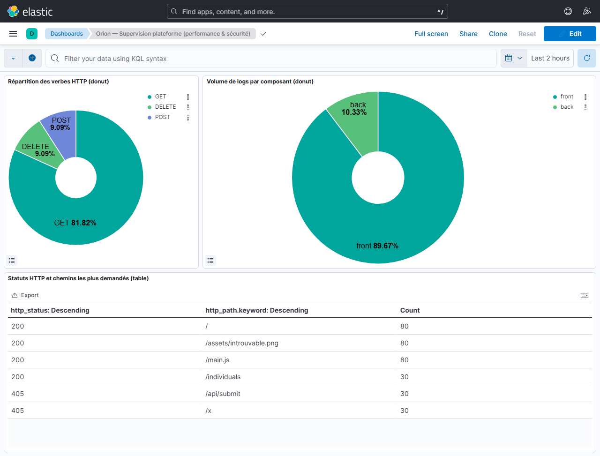
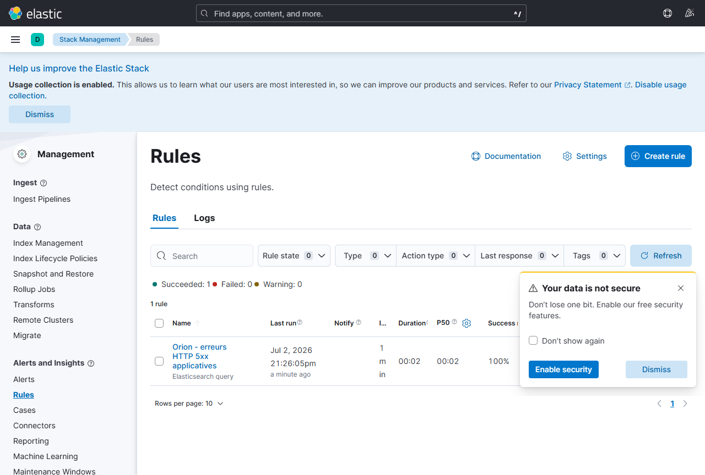
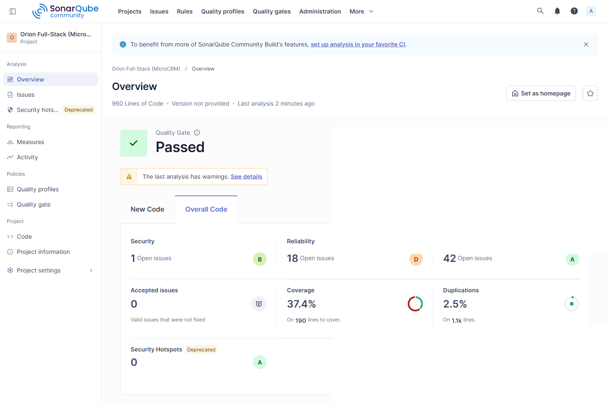

# Rapport de performance — Démarche DevOps Orion

**Destinataires** : Maria (CTO) et parties prenantes — **Auteur** : Ghislain Adon, Expert DevOps
**Version** : 2.0 — juillet 2026

---

## 1. Synthèse du projet

La mission a transformé un processus de livraison artisanal (CI limitée aux tests,
images construites sur poste, contrôle sécurité manuel après livraison, déploiement
à la main) en une **chaîne CI/CD automatisée de bout en bout, avec déploiement
continu en GitOps** :

- **Pipeline GitLab CI à 9 stages** (`.pre` promotion-guard, test, qualité,
  packaging, sécurité, back-up, verify, release, notify), exécuté à chaque commit.
- **Images Docker non-root tracées** (`<branche>-<SHA>`) publiées dans le **registre
  interne** GitLab — la dépendance DockerHub des Ops est supprimée.
- **Sécurité shift-left bloquante** : scan Trivy (CVE HIGH/CRITICAL) + audit de
  dépendances + **quality gate SonarQube** (`qualitygate.wait=true`), **câblée dans
  le DAG de déploiement** — une gate rouge empêche réellement la release.
- **Déploiement continu GitOps** : **Argo CD** réconcilie le cluster avec l'état
  déclaratif Git ; promotion contrôlée **dev → test → prod** (branches + namespaces).
  Validé en direct : commit → pipeline → release → Argo CD → application `HTTP 200`.
- **IaC** Terraform + Ansible (portabilité EKS/AKS) ; **observabilité** stack **ELK**
  + calcul automatisé des **métriques DORA**.

## 2. Métriques DORA

Mesurées par `scripts/dora_metrics.py` depuis l'API GitLab (`reports/dora_metrics.json`,
rejouable : `python scripts/dora_metrics.py --branch dev --days 30`).

| Métrique | Valeur mesurée | Lecture |
|---|---|---|
| **Deployment Frequency** | à chaque merge sur une branche d'environnement (déploiement automatique par Argo CD) | Contre « une fois en fin de sprint, à la main » auparavant |
| **Lead Time for Changes** | **≈ 6–10 min** (médiane commit → déploiement) | Contre plusieurs jours dans le processus manuel |
| **Change Failure Rate** | élevé sur la **fenêtre de construction** (mise au point + démonstrations de blocage) | Attendu : chaque échec = une **gate faisant son travail** (Trivy/Sonar) ; cible < 15 % en régime établi |
| **MTTR** | **≈ 30–40 min** (échec → succès suivant) | Diagnostic immédiat : rapports en artefacts + notifications Discord par environnement |

> Le CFR de la fenêtre de mise en place est volontairement élevé : il inclut les
> blocages **provoqués** pour valider la chaîne (CVE, quality gate rouge). En régime
> établi, il reflètera la qualité réelle des changements.

## 3. Résultats des tests et couverture (mesures réelles SonarQube)

Analyse SonarQube du **15/07/2026** — projet `orion-fullstack`, 960 lignes de code
(Java 226, TypeScript 332, HTML 401) :

| Contrôle | Résultat mesuré |
|---|---|
| **Quality gate** | ✅ **PASSED** (condition « Sonar way » : 0 nouvelle violation sur le code neuf) |
| Tests backend (JUnit 5, unitaires + intégration JPA/REST) | ✅ verts à chaque pipeline (rapports JUnit publiés dans GitLab) |
| Tests frontend (Karma/Jasmine, ChromeHeadless) | ✅ verts à chaque pipeline |
| **Couverture backend (JaCoCo)** | **56,4 %** de lignes (code métier `microcrm`) |
| **Couverture frontend (lcov)** | **27,0 %** de lignes (statements 33 %, fonctions 29 %) — désormais **ingérée** dans SonarQube |
| **Couverture globale (SonarQube)** | **37,4 %** de lignes (41,1 % en couverture de lignes, 190 lignes à couvrir) |
| Analyse statique (SonarQube) | Fiabilité 18 issues (note D), Sécurité 1 (B), Maintenabilité 42 (A), 0 hotspot, duplication **2,5 %** (< 3 %) sur 960 lignes |
| Smoke test de déploiement | ✅ en CI (dind) **et** cluster : services `HTTP 200` |
| Déploiement Kubernetes (Argo CD) | ✅ namespace `dev` : `microcrm-dev-back` + `-front` `Running 1/1`, front `HTTP 200` sur `:30080`, application Argo CD **Synced + Healthy** |

**Lecture honnête** : la couverture backend (56,4 %) est proche de la cible 60 % ;
la couverture frontend (27,0 %) est maintenant **correctement remontée** dans
SonarQube (reporter `lcovonly` ajouté à Karma). La couverture globale (37,4 %) est
mesurée et non plus déclarative — elle reste sous les cibles (progressivité assumée,
cf. §7.1), mais elle est **réelle et suivie**.

## 4. Sécurité — deux cas réels traités par la chaîne

**a) Remédiation des 28 CVE initiales.** Le premier passage a **bloqué 28
vulnérabilités** (dont **4 CRITICAL** sur le Tomcat embarqué) — le scénario même des
« retours à l'envoyeur » vécu par les Ops, désormais détecté **avant** livraison :

| Itération | Action | Résultat |
|---|---|---|
| 1 | Scan initial | 26 CVE back (4 CRITICAL Tomcat 10.1.20, jackson, spring) + 2 front + 2 OS |
| 2 | Spring Boot 3.2.5 → 3.5.14, Tomcat 10.1.55, json-smart 2.5.2, `apk upgrade` | Reste 2 CVE (jackson via BOM) |
| 3 | `jackson-bom` 2.21.4 ; CVE Go du binaire Caddy **gouvernées** dans `.trivyignore` | ✅ **0 CVE bloquante** |

**b) CVE-2026-39822 — la gate vit (nouvel incident, juillet 2026).** Lors du test de
la pipeline sur la branche `dev`, `trivy-front` a **bloqué** sur une CVE **HIGH**
apparue *depuis* dans la base Trivy : vulnérabilité de la **stdlib Go** (`os.Root`,
symlink following) **compilée dans le binaire Caddy**. Non corrigeable par
`apk upgrade`, aucune image Caddy patchée publiée → **exception `.trivyignore`
justifiée et datée** (front non exposé, aucun symlink dans `/app/front`, réévaluation
à chaque release Caddy). Preuve que la sécurité est **vivante et gouvernée**, pas figée.

**c) Quality gate réellement bloquante.** Démonstration validée : un identifiant en
dur introduit dans le code fait passer la gate au **rouge** → le job `sonarqube`
échoue → `gitops-release` est **omis** (`needs: sonarqube optional`) → **aucun
déploiement**. La gate bloque la *release*, pas seulement le statut du pipeline.

## 5. Captures du monitoring

**Dashboard Kibana « Orion — Supervision plateforme »** — visualisations sur les
access logs JSON de Caddy parsés par Logstash (verbes HTTP, volume par composant,
statuts HTTP × chemins) :



**Règle d'alerte** « erreurs HTTP 5xx applicatives » (Elasticsearch `http_status ≥ 500`,
fenêtre 5 min) :



**Dashboard SonarQube** — quality gate **PASSED** (Overall Code) : Fiabilité 18
issues (D), Sécurité 1 (B), Maintenabilité 42 (A), 0 hotspot, couverture **37,4 %**
(backend 56,4 %, frontend 27,0 %), duplication 2,5 %, sur 960 lignes :



**Argo CD** — application `microcrm-dev` **Synced/Healthy**, déploiement continu
depuis Git (preuve texte `captures/argocd-dev.txt`) :

```
$ kubectl -n argocd get applications
NAME           SYNC STATUS   HEALTH STATUS
microcrm-dev   Synced        Healthy
$ kubectl -n dev get pods
microcrm-dev-back-…    1/1   Running
microcrm-dev-front-…   1/1   Running    (front HTTP 200 sur :30080)
```

Également joints : `captures/kibana-discover.png` (exploration des logs),
`captures/argocd-dev.txt` et `captures/kubectl-pods.txt` (état du cluster). Les
rapports JUnit, Trivy et les archives de back-up sont consultables dans l'onglet
CI/CD du dépôt GitLab.

## 6. Gains obtenus

| Avant | Après |
|---|---|
| Images construites sur poste en fin de sprint | Images construites/publiées à **chaque commit**, traçables au SHA |
| Scan sécurité manuel, après livraison | Scan **bloquant dans le pipeline**, exceptions gouvernées |
| Déploiement manuel (2 personnes, commandes Docker) | **Déploiement continu GitOps** (Argo CD) sur dev/test/prod, self-heal |
| Aucune quality gate | **Quality gate SonarQube bloquant la release** (câblée au DAG) |
| Dépendance DockerHub | Registre interne GitLab |
| Feedback en jours (fin de sprint) | Feedback en **< 15 min** (pipeline + notification Discord par environnement) |
| Aucune mesure | Couverture, rapports de tests, métriques DORA automatisées |

## 7. Recommandations d'amélioration continue

1. **Relever la couverture par paliers** : la couverture front est désormais
   ingérée (reporter Karma `lcovonly`) — back 56,4 %, front 27,0 %, global 37,4 %.
   Objectif : remonter progressivement vers les cibles (60 → 80 %) en ajoutant des
   tests, front en priorité (composants peu couverts).
2. **SonarQube hébergé** (au lieu du tunnel Cloudflare depuis un poste) pour une
   disponibilité permanente de la gate, et **runner self-hosted** (vitesse/coût).
3. **Releases sémantiques** : brancher semantic-release (Conventional Commits en place).
4. **Prod cloud managé** (EKS/AKS) avec les **mêmes charts Helm** (portabilité déjà en place),
   et **review apps** éphémères par merge request.
5. **Étendre l'observabilité** : dashboards Kibana (latences, taux d'erreur par
   endpoint), alerting DORA (seuils → Discord), et back-up des données (bascule PostgreSQL).
6. **Montée en compétence** : pair-testing JUnit senior/junior (point faible Dev) ;
   rotation Ops sur la maintenance du pipeline.
